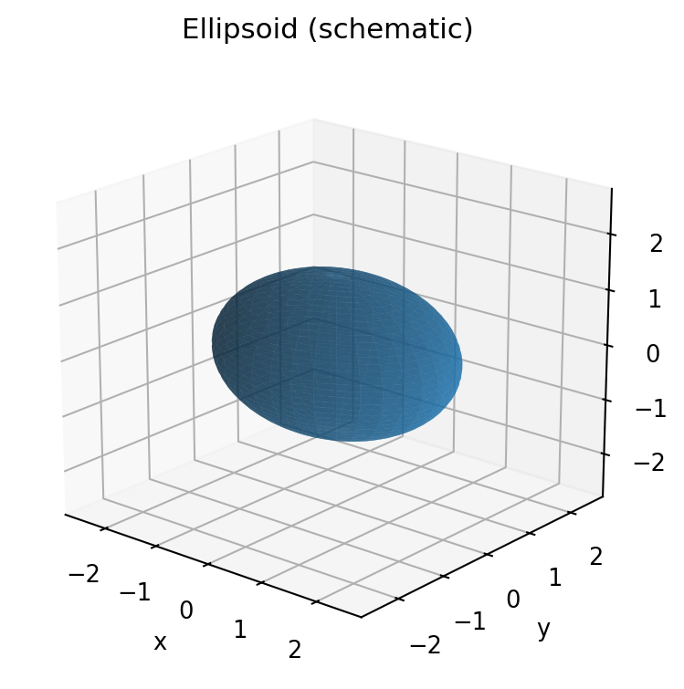
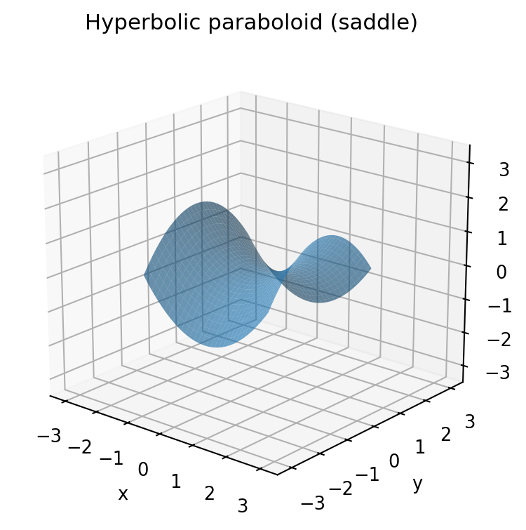

# 空间解析几何习题详解与图解

> **逐题推导 · 书后答案独立核查 · 几何图解 · 可复现 LaTeX/PDF**  
> 当前版本：**v3.0（前三章）** ｜ 已整理 **217 道编号习题** ｜ 含各题小问 ｜ 持续订正中

本项目依据《空间解析几何》教材的习题顺序，对题目进行**独立求解、答案对照、图形辅助讲解与可追溯修订**，形成便于阅读和维护的原创学习讲义。

项目不是扫描教材的转存，也不是出版社的官方答案或勘误。已有解析仍欢迎读者复核：**程序检查能验证部分代数关系，但不能替代对每一步几何证明的人工审查。**

## 📖 直接阅读：完整 PDF

不需要安装任何软件，点击下列文件即可在 GitHub 打开或下载。

| 分册 | 习题范围 | 编号题数 | PDF |
| :-- | :--: | --: | :-- |
| 第一章 · 向量代数 | 1.1—1.5 | 72 | [📄 第一章完整图解与解析](dist/chapter-01-vector-algebra-illustrated.pdf) |
| 第二章 · 图形与方程 | 2.1—2.7 | 82 | [📄 第二章完整图解与解析](dist/chapter-02-spatial-geometry-complete.pdf) |
| 第三章 · 坐标变换与二次曲线的分类 | 3.1—3.5 | 63 | [📄 第三章完整图解与解析](dist/chapter-03-coordinate-transform-conics-illustrated.pdf) |
| **合计** | **第一至三章** | **217** | **三份独立、可搜索的 PDF** |

**题数说明：**“217 题”按原书的编号习题统计，每题下的（1）（2）等小问归入该题，不单独增加题数。当前第四、第五章**尚未完成**，请以 [进度记录](docs/PROGRESS.md) 为准。

## ✨ 项目特色

- **逐题讲解：** 按“题意概述 → 所用知识 → 解题思路 → 推导 / 证明 → 核查结论 → 易错提醒”组织，方便从头学习，也方便对照教材查题。
- **原书答案交叉核对：** 对照书后答案与提示；对于缺少过程的题，另行补充推导；对有疑点的式子注明证据，而非直接照抄。
- **图形辅助理解：** 将分点、投影、空间直线和曲面、坐标变换、渐近线、焦点与准线等抽象概念可视化。
- **可编辑、可检索：** PDF 可搜索，主要正文基于 XeLaTeX 编译，公式与讲解可通过源代码继续修订。
- **数学回归检查：** 使用 Python、SymPy 和 NumPy 对具有代表性的坐标变换、向量恒等式、曲线 / 曲面关系进行自动验算。
- **维护记录透明：** 修订记录见 [CHANGELOG](CHANGELOG.md)，原书疑误核查见 [AUDIT](docs/AUDIT.md)，各章覆盖情况见 [PROGRESS](docs/PROGRESS.md)。

## 🧭 章节内容

### 第一章 · 向量代数（72 题）

| 习题 | 主题 | 编号题数 |
| :-- | :-- | --: |
| 1.1 | 向量的线性运算、重心、共点与共线、有向分比 | 23 |
| 1.2 | 仿射坐标系与坐标计算 | 10 |
| 1.3 | 内积、长度、投影与正交 | 14 |
| 1.4 | 外积、面积与定向 | 11 |
| 1.5 | 二重外积、混合积与有向体积 | 14 |

**建议重点：** 向量起终点次序、内积 / 外积区别、Ceva 与 Menelaus 定理的适用条件、左右手坐标系的符号问题。

### 第二章 · 图形与方程（82 题）

| 习题 | 主题 | 编号题数 |
| :-- | :-- | --: |
| 2.1 | 图形与方程、常见坐标形式 | 7 |
| 2.2 | 平面的方程与相互位置 | 12 |
| 2.3 | 空间直线的方程与位置关系 | 13 |
| 2.4 | 平面与直线的距离、夹角 | 14 |
| 2.5 | 旋转面、柱面、锥面 | 17 |
| 2.6 | 二次曲面与截线 | 8 |
| 2.7 | 直纹二次曲面及两族直母线 | 11 |

**建议重点：** 仿射坐标与直角坐标的使用范围、异面直线距离、曲面消参时是否产生增根、二次曲面退化情况。

### 第三章 · 坐标变换与二次曲线的分类（63 题）

| 习题 | 主题 | 编号题数 |
| :-- | :-- | --: |
| 3.1 | 仿射坐标变换与直角坐标变换 | 16 |
| 3.2 | 二次曲线类型及其变换 | 11 |
| 3.3 | 不变量、含参数曲线分类 | 7 |
| 3.4 | 中心、渐近线、直径、切线与共轭关系 | 24 |
| 3.5 | 对称轴、主方向与标准化 | 5 |

**建议重点：** 矩阵形式的坐标变换、二次曲线不变量 $I_1,I_2,I_3$、参数临界值、中心与渐近线、焦点—准线关系。

## 🖼️ 图解预览

第二章的三维示意图由仓库中的 Python 绘图脚本生成；各章 PDF 还包含与习题相关的数学图形。

| 椭球面 | 双曲抛物面（马鞍面） |
| :--: | :--: |
|  |  |

图像是为帮助理解制作的示意，**不代替题设条件或严格证明**。

## 📁 仓库结构

```text
spatial-geometry-verified-notes/
├── .github/workflows/
│   └── math-verify.yml        # Push / PR 时自动运行数学检查
├── chapters/
│   ├── 01/chapters/           # 第一章 LaTeX 源码
│   ├── 02/
│   │   ├── chapters/          # 第二章 LaTeX 源码
│   │   ├── figures/           # 三维示意图素材
│   │   └── scripts/           # 绘图脚本
│   └── 03/chapters/           # 第三章 LaTeX 源码
├── dist/                      # 三章已编译的 PDF
├── tests/                     # 数学核查与第三章题号检查
├── docs/
│   ├── AUDIT.md               # 独立疑误核查记录
│   ├── PROGRESS.md            # 章节进度与覆盖表
│   └── CONTRIBUTING.md        # 修订和投稿规范
├── build.sh                   # 一键生成前三章 PDF
├── requirements.txt           # Python 依赖
├── CHANGELOG.md               # 版本变化记录
└── README.md                  # 项目说明
```

## 🛠️ 本地安装与 PDF 构建

### 1. 环境要求

- **Python 3**（GitHub Actions 使用 Python 3.11）；
- **XeLaTeX**，以及 `ctex`、TikZ 等 LaTeX 宏包（可通过 TeX Live 或 MiKTeX 安装）；
- 正文字体：**Noto Serif CJK SC、Noto Sans CJK SC、Liberation Serif、Liberation Sans**；
- Python 库：见 `requirements.txt`（SymPy、NumPy、Matplotlib）。

> Windows 用户推荐通过 **WSL** 执行以下 Shell 命令；macOS / Linux 可直接在终端运行。构建脚本使用 `bash`、`python3`、`xelatex`，请确保这些命令都在 `PATH` 中。

### 2. 克隆仓库并安装依赖

```bash
git clone https://github.com/USERNAME/REPOSITORY.git
cd REPOSITORY
python3 -m pip install -r requirements.txt
```

`USERNAME` 和 `REPOSITORY` 是占位符，请替换为自己的 GitHub 用户名与仓库名。

### 3. 一键构建全部 PDF

```bash
bash build.sh
```

脚本会先生成第二章的三维绘图素材，再分别运行两轮 XeLaTeX，为三章 PDF 生成目录和交叉引用。输出存放在 **`dist/`**，对应上方下载表格中的三个文件。

### 4. 只构建第三章（示例）

```bash
cd chapters/03
mkdir -p build
xelatex -interaction=nonstopmode -halt-on-error -output-directory=build chapters/chapter-03.tex
xelatex -interaction=nonstopmode -halt-on-error -output-directory=build chapters/chapter-03.tex
```

此命令将 PDF 输出至当前目录的 `build/`；如需更新仓库 `dist/` 里的发布版，建议在项目根目录运行 `bash build.sh`。

## ✅ 独立验算与持续集成

在仓库根目录执行：

```bash
python3 -m pip install -r requirements.txt
python3 tests/verify_ch0101.py
python3 tests/verify_ch0102_0105.py
python3 tests/verify_ch02.py
python3 tests/verify_ch03.py
python3 tests/check_ch03_coverage.py
```

这些脚本用于复核代表性计算及第三章全部 **63 个编号题**的源码覆盖情况。仓库的 [GitHub Actions 工作流](.github/workflows/math-verify.yml) 会在 Push、Pull Request 时自动执行上述检查。

**检查范围说明：** 当前 Actions 检查的是数学脚本和第三章题号覆盖，**不会自动编译 PDF**；脚本全部通过也不代表 217 道题的全部证明已经机器形式化证明。

## 🔎 答案核查与疑误记录

本项目以**原题条件 → 独立推导 → 与书后结果对照**的顺序核查。若两者不一致，先检查坐标系定向、分比次序和参数范围，再列出可复现的计算或反例。

已记录的案例包括：

- **第一章：** 习题 1.1 第 5 题的向量方向冲突；习题 1.5 第 2 题的分母平方问题。
- **第二章：** 习题 2.5 第 5（1）题的椭球半轴；习题 2.6 第 8 题临界参数下的曲面类型。
- **第三章：** 习题 3.1 第 6（2）题的直线系数、第 12 题的抛物线焦点，以及习题 3.4 第 10（2）③题的弦中点直线。

详见 [独立核查与疑误登记 `docs/AUDIT.md`](docs/AUDIT.md)。**这些是独立复核意见，不是出版社确认的正式勘误**，不同教材版次可能存在差别。

## 🤝 如何参与修订

如果发现原题条件识别错误、公式符号不一致、证明步骤缺失或图示不清晰，欢迎提交 Issue 或 Pull Request，并尽量提供：

1. 章节、习题编号与教材版次 / 页码；
2. 当前讲义中存在问题的公式或推导步骤；
3. 你的计算、反例或几何理由；
4. 如有修改，相关 `chapters/` 源码、`tests/` 检查，以及必要的 `docs/AUDIT.md` / `CHANGELOG.md` 更新。

提交前建议执行上述检查并重新编译受到影响的 PDF。详细约定见 [贡献说明](docs/CONTRIBUTING.md)。

## 🗺️ 后续计划

- [x] 第一章：习题 1.1—1.5 完整整理
- [x] 第二章：习题 2.1—2.7 完整整理
- [x] 第三章：习题 3.1—3.5 完整整理
- [x] 前三章数学核查脚本与 PDF 源码统一维护
- [ ] 第四章：继续核查与制作独立分册
- [ ] 第五章：继续核查与制作独立分册
- [ ] 根据反馈持续改进错题勘误、重点题配图与文本排版

以上为项目路线图，不代表未完成章节已经发布。最新完成状态以 [PROGRESS](docs/PROGRESS.md) 为准。

## ⚖️ 声明与版权

- 本项目提供**自行撰写的解析、推导、公式排版、绘图和测试代码**，不包含原教材完整扫描件或整页复制内容。
- 教材习题及教材本身可能受到版权保护；公开分享、转载或引用时请确认相应权利与适用的许可条件。
- 解析面向学习和交流，**并非教材作者、出版社或任何考试机构的官方材料**。
- 当前仓库**没有附带 `LICENSE` 文件**。在选择正式开源许可或接受外部贡献前，请由仓库维护者明确授权方式；不能仅凭 GitHub 仓库公开可见推定可以任意复制、改编或商用。

---

如果这份讲义对你有帮助，欢迎通过 Issue 反馈题目错误、补充更清晰的证明或建议新的几何图示。**比增加题量更重要的，是让每一个结论都能解释、能复核、能修订。**
